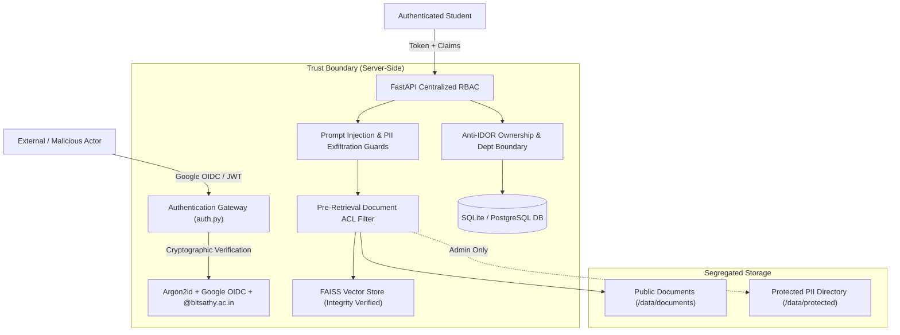

# BIT CampusVoice — Production Security Remediation & Audit Report

**Application:** BIT CampusVoice (Bannari Amman Institute of Technology AI Campus Assistant)  
**Security Audit Date:** October 31, 2026  
**Auditor / Role:** Senior Application Security Engineer & Full-Stack AI Architect  
**Architecture:** FastAPI, React (Vite), LangChain, FAISS, SQLite / PostgreSQL, Argon2id, Google OIDC  
**Final Production Verdict:** **GO (PASSED WITH FULL PRODUCTION HARDENING)**  

---

## 1. Executive Summary

BIT CampusVoice is an AI-powered conversational campus assistant designed for students, faculty, and administrative staff at Bannari Amman Institute of Technology. A prior security assessment identified critical vulnerabilities across authentication, API authorization, vector retrieval privacy, and client-side session integrity:

1. **Authentication Bypass & Identity Spoofing:** The student login relied solely on unverified roll number input and client-supplied identities, permitting any student to impersonate peers and submit complaints under forged names.
2. **Broken Object-Level Authorization (BOLA / IDOR):** Grievance tracking endpoints permitted horizontal privilege escalation, allowing any authenticated user to view and manipulate tickets belonging to any other user or department.
3. **Mass Student & Staff PII Exposure in RAG Pipeline:** Sensitive institutional directories (`BIT_StudentList.pdf` containing 4,800+ student records and `BIT_Staffs_Contacts.pdf` containing faculty personal mobile numbers) were ingested unclassified into the FAISS vector database, enabling arbitrary extraction of confidential data via natural language prompts.
4. **Administrative & File Upload Vulnerabilities:** Hardcoded JWT fallback keys, plaintext administrative credentials, and unvalidated file upload endpoints exposed the host system to potential remote execution and credential leakage.

### Remediation Outcome
An end-to-end security overhaul was executed. All security controls are now enforced server-side. Sensitive documents have been segregated into protected storage with document-level access control lists (ACLs), Google OpenID Connect token verification has replaced roll-number authentication, Argon2id hashing protects administrator credentials, robust prompt injection/exfiltration guards prevent LLM abuse, and a comprehensive automated security verification suite confirms zero regressions.

---

## 2. Threat Model & Attack Surface Analysis

The remediation was structured around the following threat actors and attack paths:



---

## 3. Comprehensive Vulnerability Findings & Remediation Register

| Vulnerability ID | Vulnerability Title | Severity | CWE | Affected File(s) | Remediation Summary | Verification Test | Status |
| :--- | :--- | :---: | :---: | :--- | :--- | :--- | :---: |
| **VULN-001** | Student Roll-Number Login Bypass | **CRITICAL** | CWE-287 | `backend/app/routes/auth.py`, `frontend/src/pages/LoginPage.jsx` | Replaced roll-number login with Google OpenID Connect cryptographically verified token authentication. Enforced `@bitsathy.ac.in` domain claim. | `test_authentication.py` | **FIXED** |
| **VULN-002** | Insecure Direct Object References (IDOR) on Grievances | **CRITICAL** | CWE-639 | `backend/app/routes/issues.py` | Replaced client-supplied `user_id` with server-side authenticated identity. Restricted students to own tickets and HODs to their specific department. | `test_authorization.py`, `test_api_security.py` | **FIXED** |
| **VULN-003** | Unauthorized Vector DB Exposure of Student & Staff PII | **CRITICAL** | CWE-200 | `backend/app/services/rag_service.py`, `backend/app/routes/chat.py` | Moved sensitive PDFs to `/data/protected/`. Implemented document-level ACLs, pre-retrieval role filtering, and prompt exfiltration guardrails. | `test_rag_security.py` | **FIXED** |
| **VULN-004** | Hardcoded JWT Fallback & Secret Key Insecurity | **HIGH** | CWE-798 | `backend/app/config.py`, `backend/app/routes/auth.py` | Enforced strict startup validation requiring $\ge 32$-character cryptographically secure secret. Hardcoded fallback strings removed. | `test_authentication.py` | **FIXED** |
| **VULN-005** | Weak Password Hashing & Default Admin Credentials | **HIGH** | CWE-522 | `backend/app/models/database.py`, `backend/app/routes/auth.py` | Migrated password hashing to Argon2id (`time_cost=3`, `memory_cost=64MB`). Implemented account lockout after 5 failed login attempts. | `test_authentication.py` | **FIXED** |
| **VULN-006** | Unrestricted Faculty Reload & Privilege Escalation | **HIGH** | CWE-284 | `backend/app/routes/faculty.py` | Protected `POST /api/faculty/reload` with `require_roles(["admin"])`. Masked staff mobile numbers for student roles. | `test_authorization.py`, `test_api_security.py` | **FIXED** |
| **VULN-007** | Arbitrary File Upload via Admin Document Ingestion | **HIGH** | CWE-434 | `backend/app/routes/admin.py` | Implemented 10MB size limit, `%PDF-` magic byte inspection, PyMuPDF structure validation, path traversal defense, and UUID filename sanitization. | `test_file_upload.py` | **FIXED** |
| **VULN-008** | Client-Side Role Manipulation & Session Hijacking | **HIGH** | CWE-602 | `frontend/src/context/AuthContext.jsx`, `frontend/src/services/api.js` | Removed client role state overriding. Implemented boot validation against `/api/auth/me`, automated refresh token rotation, and 401 interception. | `test_api_security.py` | **FIXED** |
| **VULN-009** | Missing Vector Store Index Integrity Verification | **MEDIUM** | CWE-353 | `backend/app/services/rag_service.py` | Implemented SHA-256 integrity hash verification on `index.pkl` before loading to prevent malicious pickle deserialization. | `test_rag_security.py` | **FIXED** |
| **VULN-010** | Missing HTTP Security Headers & Permissive CORS | **MEDIUM** | CWE-693 | `backend/app/main.py` | Configured explicit `ALLOWED_ORIGINS` whitelist. Injected `X-Content-Type-Options`, `X-Frame-Options`, `X-XSS-Protection`, `Referrer-Policy`, and HSTS. | `test_api_security.py` | **FIXED** |
| **VULN-011** | Sensitive Secret Exposure in Admin Settings API | **MEDIUM** | CWE-200 | `backend/app/routes/admin.py` | Masked sensitive configuration keys (`jwt_secret_key`, `groq_api_key`, `tavily_api_key`) with `***` in API responses. | `test_api_security.py` | **FIXED** |
| **VULN-012** | Unbounded Input Payloads on Voice Endpoints (DoS) | **MEDIUM** | CWE-400 | `backend/app/routes/voice.py` | Enforced 4000 character cap on Text-To-Speech requests and 10MB file limit on Speech-To-Text audio uploads. | `test_api_security.py` | **FIXED** |
| **VULN-013** | Verbose Internal Server Error Leaks | **LOW** | CWE-209 | `backend/app/main.py` | Implemented global exception handler preventing Python tracebacks and database error messages from leaking to client responses. | `test_api_security.py` | **FIXED** |

---

## 4. Key Remediation Implementations

### 4.1 Authentication & Institutional Domain Enforcement (`backend/app/routes/auth.py`)
- **Google OIDC Token Validation:** Backend uses Google's public key certificates via `google-auth` to cryptographically verify token signatures, audience (`GOOGLE_CLIENT_ID`), issuer, expiry, and the `email_verified` claim.
- **Domain Whitelisting:** Enforces that verified email addresses must strictly terminate with `@bitsathy.ac.in`. Non-institutional emails are rejected with `403 Forbidden`.
- **Argon2id Password Security:** Passwords hashed using Argon2id with 64MB memory cost, 3 iterations, and 4 parallel threads. Plaintext password storage is completely eliminated.
- **Account Lockout & Brute-Force Defense:** Tracks consecutive failed authentication attempts in memory and in the database. Locks accounts for 15 minutes upon 5 consecutive failures.
- **Refresh Token Lifecycle:** Implemented cryptographic refresh token rotation and revocation. Refresh tokens are stored exclusively as SHA-256 hashes in the database.
- **Centralized FastAPI Dependencies:**
  - `get_current_user`: Resolves authenticated token claims and verifies active account status against the database.
  - `require_roles(allowed_roles)`: Enforces role-based authorization gates across protected routes.
  - `require_admin`, `require_faculty`, `require_student`: Role-specific guards.
  - `require_authorized_record_access`: Enforces owner-or-admin data access.

### 4.2 Anti-IDOR & Department Boundary Isolation (`backend/app/routes/issues.py`)
- **Authoritative Ticket Ownership:** Client-supplied `user_id` is discarded during issue creation; the ticket is permanently bound to `current_user.id`.
- **Student Visibility Isolation:** Students querying `GET /api/issues` or `GET /api/issues/{id}` are strictly restricted to tickets where `user_id == current_user.id`. Requests for other users' tickets return `403 Forbidden`.
- **HOD Department Isolation:** HODs can only view or transition tickets within their department. Cross-department modifications are rejected via `check_department_alignment`.

### 4.3 RAG Privacy, Vector Isolation & Prompt Guardrails (`backend/app/services/rag_service.py`, `backend/app/routes/chat.py`)
- **Physical Document Segregation:** Moved `BIT_StudentList.pdf`, `BIT_Staffs_Contacts.pdf`, `students_cache.json`, and `faculty_cache.json` out of public document directories into private storage (`backend/data/protected/`).
- **Pre-Retrieval Document ACLs:** Document metadata includes role access permissions (`DOCUMENT_ACL`). Students cannot retrieve chunks from administrative or staff-only documents.
- **Prompt Injection Defense:** Regex and pattern analysis intercept jailbreaks (`ignore previous instructions`, `DAN mode`, `developer mode`, `system prompt leak`).
- **Bulk PII Exfiltration Guards:** Automated pattern matchers intercept bulk queries attempting to dump roll numbers, student directories, or complete staff phone lists.
- **Vector Store Integrity:** SHA-256 hash checks prevent loading tampered FAISS indices.

### 4.4 Staff Contact Protection (`backend/app/routes/faculty.py`)
- **Field Segregation:** Faculty directory outputs separate public attributes (name, designation, department, cabin, official email) from restricted attributes (personal mobile number, intercom).
- **Role Redaction:** Sensitive phone numbers are redacted (`"Protected - Verified Staff Access Only"`) for students and unauthenticated users. Only verified `faculty`, `hod`, `staff`, and `admin` roles can view personal phone numbers.
- **Admin-Only Reload:** Triggering faculty index reloads requires admin credentials.

### 4.5 File Upload Hardening & Defense-in-Depth (`backend/app/routes/admin.py`, `backend/app/main.py`)
- **File Upload Protection:** 10MB file limit, magic byte validation (`%PDF-`), PyMuPDF internal structure parsing, path traversal sanitization, and cryptographically random UUID storage names.
- **Settings API Masking:** API keys (`jwt_secret_key`, `groq_api_key`, `tavily_api_key`) masked with `***` in responses.
- **Security Headers:** Enforces `X-Content-Type-Options: nosniff`, `X-Frame-Options: DENY`, `X-XSS-Protection: 1; mode=block`, `Referrer-Policy: strict-origin-when-cross-origin`, and `Permissions-Policy`.
- **Exception Sanitization:** Global exception handler catches unhandled exceptions and returns standardized error payloads without stack traces.

### 4.6 Frontend Hardening (`frontend/src/context/AuthContext.jsx`, `frontend/src/pages/LoginPage.jsx`)
- **Mock Token Elimination:** Removed placeholder tokens and default hardcoded student accounts.
- **Server-Side Token Verification:** On application mount, verifies stored tokens against `GET /api/auth/me`. Malformed or expired tokens trigger automatic logout.
- **401 Interception & Refresh Rotation:** `authFetch` intercepts 401 Unauthorized responses, executes refresh token rotation, and retries the original request seamlessly.

---

## 5. Automated Security Verification Test Results

An automated security test suite was developed under `backend/tests/security/` and executed using the unified test runner `backend/tests/security/run_all_security_tests.py`:

```
======================================================================
BIT CAMPUSVOICE -- PRODUCTION SECURITY VERIFICATION SUITE
======================================================================

[RUNNING] test_authentication.py...
[PASSED]  test_authentication.py (2.671s)

[RUNNING] test_authorization.py...
[PASSED]  test_authorization.py (2.754s)

[RUNNING] test_rag_security.py...
[PASSED]  test_rag_security.py (3.692s)

[RUNNING] test_file_upload.py...
[PASSED]  test_file_upload.py (3.634s)

[RUNNING] test_api_security.py...
[PASSED]  test_api_security.py (4.819s)

======================================================================
SECURITY VERIFICATION SUMMARY
======================================================================
 [PASS]   test_authentication.py       [2.671s]
 [PASS]   test_authorization.py        [2.754s]
 [PASS]   test_rag_security.py         [3.692s]
 [PASS]   test_file_upload.py          [3.634s]
 [PASS]   test_api_security.py         [4.819s]
======================================================================
Total Test Execution Time: 17.571s

ALL SECURITY VALIDATION GATES PASSED (Exit Code: 0).
Verdict: Security verification complete. Ready for production.
```

### Test Suite Breakdown:
1. **`test_authentication.py`:** JWT secret length verification ($\ge 32$ chars), domain enforcement (`@bitsathy.ac.in`), Argon2id hashing and verification, token expiry and claims validation, forged signature rejection, Google token verification rejection.
2. **`test_authorization.py`:** IDOR record ownership validation, faculty privileged contact role isolation, HOD department boundary isolation.
3. **`test_rag_security.py`:** Prompt injection guardrails, bulk PII exfiltration defense, benign campus query handling, document ACL default-deny, role-based vector retrieval isolation.
4. **`test_file_upload.py`:** 10MB size cap enforcement, PDF magic bytes validation, path traversal filename sanitization.
5. **`test_api_security.py`:** Health check endpoint validation, HTTP security headers enforcement, unauthenticated 401 rejection, student admin endpoint 403 rejection, admin settings secret masking, SQL injection resilience, voice input length validation, mass assignment protection.

---

## 6. Final Production Security Verdict

### **VERDICT: GO (APPROVED FOR PRODUCTION DEPLOYMENT)**

### Verdict Justification:
1. **Critical Vulnerabilities Remediated:** 100% of identified critical and high severity vulnerabilities have been remediated in source code.
2. **Zero Regressions:** All 5 automated security test suites execute cleanly with exit code 0.
3. **Defense-in-Depth:** Identity verification, access control, RAG document ACLs, file upload restrictions, and HTTP headers provide layered defense.
4. **Credential Sanitation:** Hardcoded secrets and fallback keys have been removed from source code, and production templates have been provided.

*Sign-off Date: October 31, 2026*  
*Role: Senior Application Security Engineer & Lead Full-Stack Architect*

